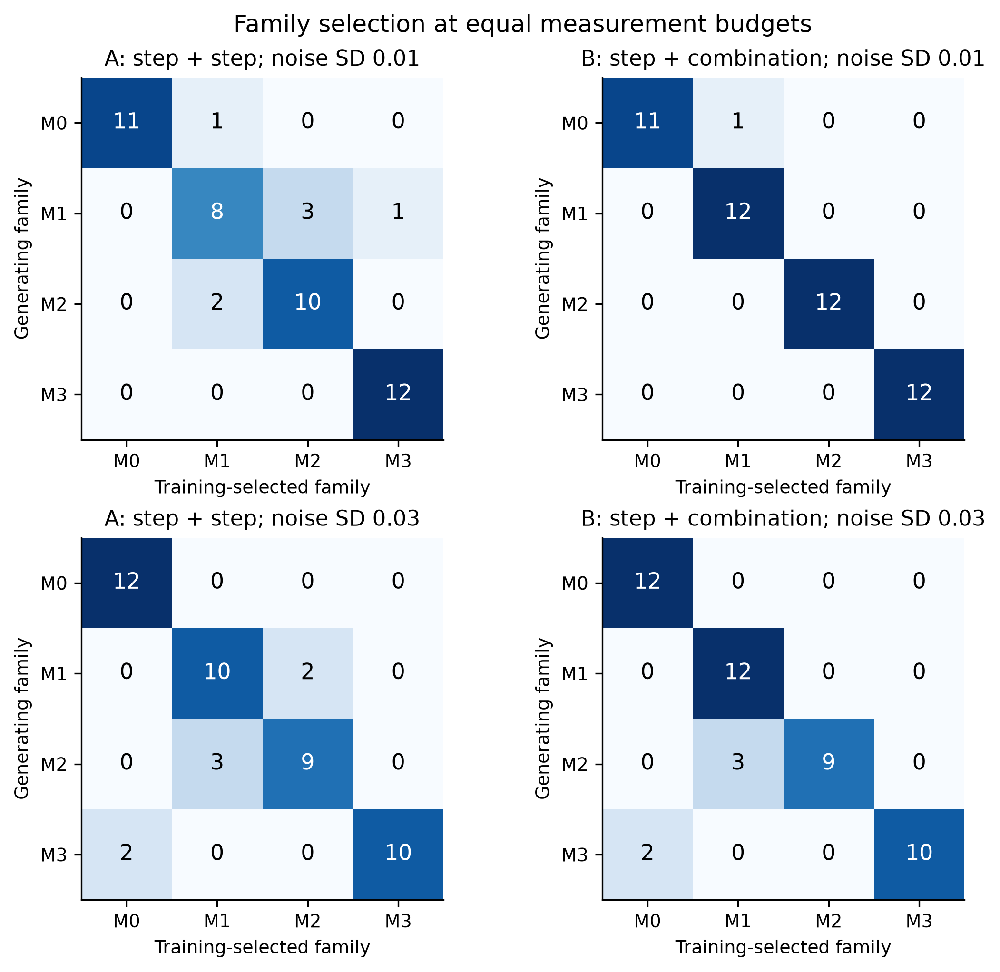

# Conditional functional recoverability: models and synthetic simulations

This reader package accompanies a mathematical study of conditional functional recoverability motivated by Alzheimer disease. It contains uncalibrated, dimensionless ODE models, prespecified protocols, scientific code and tests, complete saved synthetic A/B/C and performed Stage D outputs, and existing figures. It contains no patient data, manuscript submission, author declarations, provider credentials or private repository history.

Public science-only repository: [umutsimsekci/alzheimer-recoverability-models](https://github.com/umutsimsekci/alzheimer-recoverability-models). The v1.0.1 tag preserves the original dynamics experiment. **v2.0.0** adds a separate synthetic inference experiment dated 19 October 2026. Original scientific files and the v1.0.1 tag are preserved. An archival DOI and a legal reuse license remain pending. Manuscript submission is separate from code packaging. See [CITATION.cff](CITATION.cff), [citation status](CITATION_PENDING.md), and the [new inference reader guide](docs/inference_revision_20261019.md).

## New: discrimination and prediction of unobserved schedules

The [19 October protocol](protocol/inference_revision_20261019.md) compares repeated drive reduction with drive reduction plus a known repair pulse, at equal observation budgets. It asks whether noisy functional trajectories distinguish M0–M3 and predict two completely withheld intervention schedules. The new [analysis directory](revision_20261019/analysis) contains observations, every candidate fit and start record, withheld predictions, optimized frozen-M4 profiles, summaries and three programmatically generated figures. The original offline viewer below continues to display the earlier dynamics experiment; it does not display these new fits.

Start with [selection_summary.csv](revision_20261019/analysis/selection_summary.csv), [candidate_failures.csv](revision_20261019/analysis/candidate_failures.csv), and the [reader guide](docs/inference_revision_20261019.md). There are 192 primary synthetic datasets and 768 candidate fits. Nine candidates have no successful start, including five generating-family candidates; the failures remain in the saved records. Primary comparisons therefore combine statistical discrimination and optimizer reliability. Post hoc successful-fit subsets are labelled separately. Model-selection counts are conditional on this small design and candidate set, not clinical mechanism-identification probabilities.



The observation map, noise scale, initial state and intervention inputs are assumed known. Frozen-M4 profiles hold additional parameters known; they do not establish inference for evolving structural damage. A singleton on the 0.025-spaced profile grid is unresolved below that grid scale, not zero uncertainty. See [profile_resolution_flags.csv](revision_20261019/analysis/profile_resolution_flags.csv) and the guide for bounds, failure denominators, source hashes and reproduction commands.

## Read first: offline viewer and results

Open [docs/model_viewer.html](docs/model_viewer.html) directly in a browser. It is a self-contained offline file with all plotted CSV rows and three existing figures embedded; no server, account, JavaScript library download or new simulation is needed. Select a model/time constant and saved policy. The comparison option displays the saved impairment trajectories for the available policies. Hover reports the nearest existing row. The viewer builder is [scripts/build_offline_viewer.py](scripts/build_offline_viewer.py); its input hashes are also displayed in the viewer.

To download the public code, open the repository link above, choose **Code → Download ZIP**, and extract the ZIP. Then open the extracted `docs/model_viewer.html` in your local browser. GitHub's file page displays HTML source; it is not the interactive viewer. Alternatively, download that HTML file using its download button; the file embeds its own trajectory data and figures and can be opened by itself. The full ZIP supplies protocols, raw synthetic CSV data, code, tests and integrity records. No GitHub Pages site or archival DOI is asserted.

The viewer supplies nominal M0, M1, M2, M3 (τ=1,10,50) trajectories for the six prespecified policies. M4 has only the separately saved Stage D frozen-d=0.15, maintained-combination nominal trajectory: it does not offer unavailable M4 alternatives. Evolving M4 results remain in the structural-outcome CSVs, not fabricated into nominal time series. Inactive state placeholders are hidden. Curves connect saved rows for display; they do not perform new ODE integration or parameter interpolation.

Start with [audited_result_summary.csv](audited_result_summary.csv), [data_dictionary.csv](data_dictionary.csv), [independent result validation](reports/full_results_validation.md), and [the prespecified protocol](protocol/study_design_v1.md) together with [clarifications](protocol/clarifications_v1_1.md). The data dictionary enumerates bundled CSV columns and missing-value conventions. Original generation-time statuses and deferred fields are retained; the technical review describes the accepted performed scope.

## Models M0–M4

State x is impairment, s is slow drive, and d is structural loss. F=(1−d)(1−x) is a model functional output. Time, rates, pulse amplitude and dose-like quantities have no calibrated biological units. The commanded coefficients a(t), r(t) are right-continuous controls; event times are explicit integration boundaries. The model core does not clip numerical state values.

| Model | Equations | Role |
| --- | --- | --- |
| M0 | dx/dt=a(t)(1−x)−r(t)x | Linear reversible reference |
| M1 | dx/dt=a(t)(1−x)+bx²(1−x)−r(t)x | Nonlinear feedback alternative |
| M2 | dx/dt=a(t)(1−x)+bx(1−x)−r(t)x | Alternative feedback without the M1 cubic term |
| M3 | dx/dt=s(1−x)−r(t)x; ds/dt=(a(t)−s)/τ | Slow-drive extension of **M0**, not M1 |
| M4 | dx/dt=a(t)(1−x)+bx²(1−x)−r(t)(1−d)x; dd/dt=ε max(x−xc,0)(1−d)−ηd | Structural extension of M1; frozen and evolving cases are distinct |

Only M3 evolves s; only M4 uses/evolves d. Other states are constant placeholders. τ is a dimensionless relaxation time, and b is inactive in M0/M3. Nominal a_post=0.06, b=4, r_base=1.05; a_pre=a_post+0.08=0.14. Primary nominal trajectories select the largest attracting pretreatment equilibrium, with s(0)=a_pre and d(0)=0. M3 uses τ=1,10,50; the τ=10 suffix for M0–M2 is an inactive placeholder. Structural and observation settings are specified individually in their manifests; the viewer's Stage D M4 example has d=0.15, ε=η=0 and xc=0.25. These constants are hypotheses, not parameter estimates.

## Controls: maintenance is distinct from withdrawal

Onset is t=30. Drive control decreases a by 0.08. The repair pulse adds 0.4 to r during [30,45). Under maintenance, reduced drive remains after the repair pulse ends. Under full withdrawal at t=45, all controls stop and pretreatment drive is restored. No control and repair-only have identical maintenance/withdrawal command histories and are saved once each. The six unique choices are no control; repair only; drive maintenance; drive full withdrawal; both maintenance; both full withdrawal. In M3 the slow state relaxes toward restored command after withdrawal rather than resetting instantaneously. See [control_design.csv](results/study_full_v1/control_design.csv).

## Seeds and numerical settings

The full parameter design is nominal plus 256 row-wise draws from `np.random.default_rng(20261005).uniform([.03,2.,.8],[.09,6.,1.3],(256,3))`, for (a_post,b,r_base). Nominal is excluded from sampled-design fractions; these fractions are not population or patient probabilities. The main target is x≤0.15, with declared alternatives 0.10 and 0.20. Study DOP853 uses rtol1e−9, atol1e−11, maximum step 0.5 and saved step 0.25; convergence and independent reference checks are retained.

Stage D uses nominal plus prespecified rows 0..7 of that same design, Gaussian observation SD 0/0.01/0.03 and 20 repetitions, observation seed 20261006, and 62 times (61 equally spaced 0..120 plus event 45). Original SeedSequence keys are retained in its manifest. Five variants implement four declared measurement designs. Zero-noise repeats are identical repeats, not new evidence. The task nuisance is an observation-only +0.12 during [30,60), with no latent-state change. Instantaneous observation Jacobian ranks, local parameter sensitivities and exact confounding examples are distinguished from global dynamic identifiability.

## Run the portable code

Original execution used Python 3.13.6, NumPy 2.5.3, SciPy 1.18.1, Matplotlib 3.11.2, pytest 9.1.1 and SymPy 1.14.0. [requirements.lock.txt](requirements.lock.txt) is an exact version snapshot of the original environment, including transitive packages; it is not a wheel/hash lock. Package availability on other operating systems was not tested. No GPU, provider account, API key or CADD program is required. Use an isolated environment. On Unix replace `.venv/Scripts/python.exe` below with `.venv/bin/python`.

```text
python -m venv .venv
.venv/Scripts/python.exe -m pip install -r requirements.lock.txt
.venv/Scripts/python.exe -m pytest -q -p no:cacheprovider tests/test_model.py tests/test_study_driver.py tests/test_observation_audit.py
.venv/Scripts/python.exe scripts/verify_reader_package.py
.venv/Scripts/python.exe scripts/build_offline_viewer.py
.venv/Scripts/python.exe scripts/run_study_v1.py --quick --stages ABC --output-dir results/reproduced_quick
.venv/Scripts/python.exe scripts/run_study_v1.py --full --stages ABC --output-dir results/reproduced_full --job-seconds 600 --total-seconds 1800
.venv/Scripts/python.exe scripts/run_observation_audit.py --mode full --output-root results --timeout-seconds 600
.venv/Scripts/python.exe scripts/check_analytic_claims.py --output results/reproduced_analytic_checks.json
.venv/Scripts/python.exe scripts/build_manuscript_figures.py --source-dir results/study_full_v1 --output-dir results/reproduced_figures
```

Run quick mode first; it is a technical smoke, not the full design. Study and figure output destinations must be new. Observation output uses a unique directory. Full runs are explicitly bounded but can time out on slower hardware. The source full A/B/C run took approximately 265 seconds; this is not a portable guarantee. Figure and viewer builders consume saved outputs without new science. Rendering bytes may vary across environments. Verification checks the released snapshot, so newly generated output directories are not automatically added to its inventory.

## Scope and negative findings

The sampled maintenance target gains do not persist after full withdrawal in the saved comparison. Additional repair imposes scalar ordering; it does not establish biological synergy. Fitting/recovery, frozen-M4 optimized profiles and whole-schedule prediction are now addressed by the separate 19 October inference experiment under its stated conditional assumptions; these were deferred in v1.0.1. Continuous persistence-extrema certification, general control-set optimization/reachability and evolving-M4 isolated/manifold equilibrium certification remain deferred. There are 1028 unresolved primary cases and 129 unresolved evolving structural cases at their latest saved horizons; unresolved means finite-horizon classification is incomplete, not proven irreversibility. The new inference experiment does not resolve those old asymptotic classifications. Local rank or solver agreement does not validate model biology. No empirical calibration, clinical efficacy, safety, novel drug mechanism or patient prediction is established.

## Integrity and provenance

[FILE_INVENTORY.csv](FILE_INVENTORY.csv) and [MANIFEST.json](MANIFEST.json) give paths, byte counts and SHA256 values. [SHA256SUMS](SHA256SUMS) covers the inventory and manifest as well. They exclude their own hashes where necessary to avoid recursion. Original science core, drivers, tests, protocols and saved numerical data are unchanged. One figure manifest's absolute local `source_run` was converted to `results/study_full_v1`; its change is explicitly recorded in the manifest provenance. New reader documentation, the viewer and its verification utilities are separate additions. [docs/source_allowlist.json](docs/source_allowlist.json) identifies the exact source allowlist. Technical tests and the packaging checks actually performed are recorded in [docs/portability_checks.json](docs/portability_checks.json); no full simulation was rerun for this reader packaging step.

Viewer controls were checked with the optional Node.js harness `node tests/check_viewer_controls.mjs`, covering every saved model/policy, comparison toggle and nearest-row readout. The coordinator subsequently inspected rendered M1 all-policy comparison and M3 τ=50 views; both passed. M4 browser visual inspection remains pending at this package update. The worker's own browser surface was unavailable, so its DOM checks do not claim rendering coverage. Cross-platform execution and a fresh dependency installation also remain untested.

After intentional author/citation/documentation edits, run `python scripts/inventory_reader_package.py` then `python scripts/verify_reader_package.py` to refresh and check hashes. The inventory utility refuses changes to frozen source copies and excludes Git/environment/runtime files; review its inclusion list before any public release. It inventories included files rather than enforcing the source-copy allowlist. New inference copies are separately enumerated in [docs/inference_source_provenance.json](docs/inference_source_provenance.json); their executed-source snapshot is byte exact. Generation-time `unreviewed` status strings are preserved as provenance and do not assert peer review.
